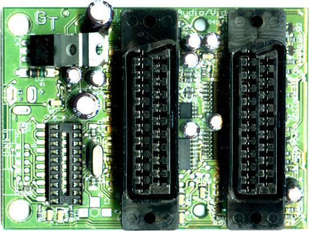

# TV Cabo box scrambler / descrambler

## About the project

The **V41** was a small video processor built around an Atmel AT90S1200
microcontroller, a 4051 analog multiplexer, 4066 analog switches and a 10 MHz crystal pulled to lock onto the incoming line synchronisation.

It circulated in Portugal under several names, including,
**Processador de Vídeo Multifunções**, **Dejav** and **"Box TVRabo"** 
from arround 1997 until arround 2007. 

This repository preserves its firmware and schematic and adds a compatible encoder.



Boxes like this were used in Portugal to descramble analog pay-TV channels without authorisation, until the cable
operators moved to digital. The decoder presented here is a real source code that was shared on the internet at the time, the original autor name is Luis and used the nick name **Gremlins** in foruns at the time (2002-2006).

The box watched the line sync and re-inverted the parts of the picture that the operator had inverted, namely the video and the colour burst. One data line per field (lines 5 and 317) told it which parts to flip.
Other variations also scrambled audio.

This repository is a technical and historical preservation of that design, and
nothing in it touches any current service. It contains:

- the decoder firmware, with its original (Portuguese) comments;
- a new encoder, so the same hardware can also produce a coded signal;
- an optional shared-key mode, so that only paired encoder and decoder boards
  decode each other;
- the schematic, protocol notes, and an emulator with tests.

It is aimed at retro-video enthusiasts, people studying analog TV and embedded
firmware, and anyone who wants a private, self-contained scrambler / descrambler
pair for their own signals. 

> **Status:** validated only in an emulator, not on real hardware.


### Purpose of this repository

This repository is a **technical and historical preservation** of the design. It contains the decoder firmware with its original comments, a new encoder that lets the same hardware produce a coded signal, an optional shared-key mode so that only paired boards decode each other, the schematic, protocol notes and an emulator with tests. It does not interact with any current available service as all have swiched to digital. Receiving paid services without a subscription is illegal in most jurisdictions, and this project does not support it.


### Known Enforcement, 2004–2007

| Date | Event |
|---|---|
| Feb 2004 | TV Cabo files more than 50 complaints with the police about  piracy equipments (*Público* headline). |
| 25 Mar 2004 | During the Inter Milan–Benfica match on SportTV, TV Cabo changes the code and synchronisation on illegal digital units. *Correio da Manhã* reports measures aimed at "caixas caseiras ilegais" (illegal home-made boxes) and any unit TV Cabo did not sell. A TV Cabo source calls it the first yellow card against piracy. However, the internet community was not discouraged, by the next morning, someone had already found a way around the change (a v42 closed souce, not the provided here), which was then sold at high prices on electronics stores.|
| Sep 2005 | Three suspects are arrested in operations in Cascais, Leiria and Porto, with dozens of "boxes", computers and software CDs seized. Illegal access is said to sell for about €100 or less. The tip-offs came from FEVIP, the video publishers' anti-piracy association. |
| Oct 2006 | The Council of Ministers approves a decree, later Decreto-Lei 176/2007, that also punishes private users of "ilegal devices", with fines of roughly €500 to €3,740. The government estimates 40,000 to 80,000 illegal connections, and Portugal Telecom reports more than 250 crime process under way. |
| May 2007 | TV Cabo announces a €15 million card swap for its digital customers (about 800,000). |
| Dec 2007 | The first convictions are reported: two men from a shop in Valongo receive 80 days of effective prison for altering equipment to unlock TV Cabo channels. |


## What it does

The decoder locks to the 15.625 kHz line sync, counts lines, and when it sees
the reference pulse pairs it enters *coded mode*. In coded mode the picture is
inverted (video and/or burst, window by window) and two **data lines** (5 and
317) tell it, field by field, which parts are inverted; it re-inverts them with
the 4051. The encoder does the reverse: from a clean PAL input it regenerates
sync/burst/video windows and inserts the reference pulses and data lines.


## Firmware for the **V41 / "TVRabo box"** SCART video board: a 10 MHz AT90S1200,
a 4051 analog multiplexer, 4066 switches and a VCXO-locked line clock.

| | |
|---|---|
| `firmware/decoder.asm` | The original **decoder** (descrambler) firmware, with comments, plus an *optional* shared-key hook (`[KEY]`). Default = original behaviour. |
| `firmware/encoder.asm` | **Encoder** that produces the coded PAL the decoder understands. |
| `firmware/key.inc` | EEPROM image of the key. Default = erased = **standard mode**. |
| `tools/keytool.py` | Create / edit / inspect keys, write `.inc` and Intel-HEX EEPROM images. |
| `hardware/` | Schematic, PCB and notes. |
| `docs/PROTOCOL.md` | The coded-signal format, PAL B/G timing and the key scheme. |
| `sim/`, `tests/` | Cycle-accurate AVR emulator + closed-loop tests (Python 3, numpy). |
| `USAGE.md` | **How to build, program, wire and use it – and how to create/edit a shared key.** |

## Standard vs keyed mode

* **Standard mode (default).** EEPROM erased (`FF FF FF FF`). The decoder behaves
  exactly like the original firmware, so the   encoder is compatible with the *unmodified* decoder firmware.
* **Keyed mode.** The same flash image, but a 4-byte key in EEPROM. Only an
  encoder and decoder with the **same key** reproduce the same data-line masks and
  decode each other; with a different key (or one side in standard mode) the
  inversion flags are decoded wrongly and the picture stays scrambled/flickering.

> **This is obfuscation / pairing, not cryptography.** The mask is a keyed
> permutation of a 5-bit counter that is transmitted in clear (32 values), so
> anyone who can record the video can tabulate the masks and build a
> compatible decoder without knowing the key. See `docs/PROTOCOL.md` §6.

## Quick start

```
python3 tests/run_tests.py quick          # emulator self-test (about a minute)
python3 tools/keytool.py gen mykey        # make a key (optional)
avrasm2 -fI firmware/decoder.asm          # or your AVR assembler; flash = decoder
avrdude -p 1200 -c <prog> -U eeprom:w:keys/mykey.eep.hex:i   # write key (optional)
```
Full details: **[USAGE.md](USAGE.md)**.

## Status – read this

* Everything was validated **only in an emulator** (AVR core + a simple analog
  model of the board).
* The sources use an AVRASM-style dialect (`.def .equ exp2() low() high() .eseg .db .include`).
  They were assembled/run with the bundled Python mini-assembler, **not yet with
  Atmel AVRASM2**. Expect to fix small syntax details.
* The encoder fills the AT90S1200 flash completely (512/512 words) and uses all
  3 hardware stack levels; the decoder ISR has ~34 cycles of margin left in the
  data-line routine with the key mixer (`KEYLEN = 4`).
* Assumptions that need a scope: data-slicer threshold, analog inversion, burst
  phase, the exact bit alignment of the data lines (see USAGE.md §7).

## License

See `LICENSE`.
