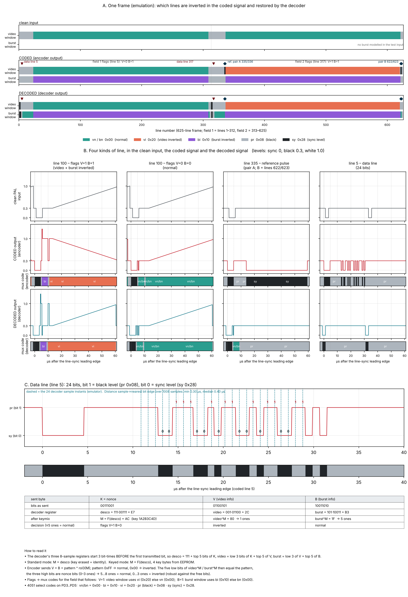

# Coded-signal protocol, PAL B/G timing and key scheme

Everything here was derived from the decoder firmware and checked in an emulator; **not measured on
real hardware**. Times in µs, "cycle" = 0.1 µs (10 MHz). One TV line = 64 µs = 640 cycles; the firmware
works in 32 µs "sections" (320 cycles, Timer0 overflow) – a line start section and a mid-line section.

## 1. Relation to PAL B/G (625 lines, 50 Hz, 15.625 kHz)
| PAL B/G item | Value | Used by firmware |
|---|---|---|
| line | 64 µs | 2 sections of 32 µs |
| line sync | 4.7 µs | regenerated by encoder (4.6 µs) every line |
| burst | ~10 cycles of 4.43 MHz, back porch | window code `bn/bi` |
| active video | ~52 µs | window code `vn/vi` (lines 24–308, 337–621) |
| field sync | broad pulses, lines 1–5 (field 1) / 313–318 (field 2) | encoder uses *input* VBI only to find the field (3 broad line-starts = field 1, 2 = field 2) |
| decoder line counter | = line number | wraps at 625 |

## 2. Mux codes (4051, PD3..PD5)
`vn=0x00` video normal, `vi=0x20` video inverted, `bn=0x00`/`bi=0x10` burst normal/inverted,
`pr=0x08` black, `sy=0x28` sync level.

## 3. What the coded signal looks like
* **Every line** is regenerated: sync (4.6 µs) – black – burst window – video window. No equalising/broad pulses.
* **Reference pulse pairs**: sync-level pulse from +14 µs to ~+59 µs after the line start on lines
  335+336 (pair A) and 622+623 (pair B). The decoder tests the comparator at +22.0 µs and +30.7 µs;
  both must be at sync level. Pair B with counter 623 enters coded mode and restarts the zone machine.
* **Data lines 5 and 317**: 24 bits, bit 1 = black level, bit 0 = sync level, ~0.775 µs per bit
  (sample instants `t_k = 131 + 8·(k mod 4) + 31·(k div 4)` cycles after the line edge).
  Bytes: `K`, `V`, `B`.
* **Inversion windows** (selected per field by the two flags): video lines 24–308 and 337–621
  (line 621 only the line-start section); burst inverted on the same lines.
* The four (video, burst) combinations rotate field by field (the encoder takes the flags from bits 1 and 2 of its data-line counter; bit 0 would lock the video flag to the field because there are two data lines per frame); `K` advances by `0x3B` per data line.

## 4. How the decoder reads the data line (important detail)
The decoder reads three registers `desco`, `video`, `burst` with a sentinel-terminated shift loop,
8 samples each. In practice (emulation, probed with known bytes) its sampling window starts
**3 bit-times before the first transmitted bit**, so:

```
desco = 1 1 1 K7 K6 K5 K4 K3                      (= 0xE0 | K>>3)
video = K2 K1 K0 V7 V6 V5 V4 V3
burst = V2 V1 V0 B7 B6 B5 B4 B3
```
It then forms `video ^= desco`, `burst ^= desco`, counts ones: **>= 5 ones = normal, <= 4 = inverted**.
The encoder sends `V = B = pattern ^ mask` with pattern `0xFF` (normal) / `0x00` (inverted): the five low
bits of the XOR equal the pattern (5 ones or 0), the three high bits are nonce bits (0–3 ones), so the
decision is robust (5..8 vs 0..3).

## 5. Key scheme
Decoder (`keymix`, only change to the original firmware): after the bits are read and the zone outputs
are done, `desco := F(desco)` with the 4-byte EEPROM key `k[0..3]`:

```
for i = 3..0:  t = k[i] + 1 ; X = swap(X + t) ^ t        (swap = rotate by 4)
```
With the erased EEPROM (`FF`) `t = 0` every step, so `X = swap(X)` four times = **identity** → original
behaviour (bit-exact output vs the original firmware in emulation). The encoder computes
`M = F(0xE0 | K>>3)` and sends `V = B = pattern ^ rol3(M)` (so that `M[4:0]` lines up with the bits
the decoder compares). `tools/keytool.py` contains the same functions (`F`, `encoder_mask`) and the test-suite
checks decoder and encoder firmware against them for every input.

Cost: ~127 cycles in the decoder data-line ISR (worst Timer0 count at ISR end 90 of a 124 limit with
`KEYLEN=4`; 6 bytes leaves ~12 cycles – not recommended). `KEYLEN` must be even.

## 6. Security – what this does *not* give you
* The nonce is only `K>>3` (32 values) sent in clear every data line, and the masks are visible on the
  video line (`V ^ ...`). Anyone who records the signal can tabulate nonce → mask for all 32 values and
  decode without the key. It is a pairing/obfuscation scheme.
* A wrong or missing key does not lock the decoder out; it makes it mis-decode the inversion flags (in
  emulation about half of the data lines still decode to the right flags by chance), so the picture is mostly,
  not always, scrambled.
* Real protection would need a cipher and proper key exchange, which does not fit 512 words and the
  fixed decoder protocol.

## 7. Resource budget
Encoder 512/512 words, 3/3 stack levels. Decoder 463/512 words, 2/3 stack levels.

## 8. Figures (generated from the emulation, `tools/make_figures.py`)



Separate files: `img/fig_a_frame.png` (one frame: which lines are inverted and restored, reference pulse
lines, data lines), `img/fig_b_lines.png` (clean input / coded / decoded waveform plus the 4051 code of a
video+burst-inverted line, a normal line, a reference-pulse line and a data line) and
`img/fig_c_data_line.png` (the 24 data bits, the decoder's sample instants, the K/V/B byte mapping and the
decision).

Notes on reading them:
* They are an **emulation** with a test ramp as video and **no burst** in the input; levels are sync 0, black 0.3, white 1.0.
* In an inverted line the sync tip right after the line start is also inverted for a moment (the video window of the
  previous line is still open when the next line starts), visible as a short peak above white.
* On the data line the *decoder* output shows a ~2 µs sync-level pulse around 31 µs: that is the original
  firmware's behaviour after the bits are read (`out zonaC`, wait, `out zonaD`).
* **Sampling margin.** With `PAD0 = 11` the decoder's sample instants fall 0.30 µs (minimum) and 0.40 µs (median) away
  from the nearest bit edge over 1008 samples (a bit cell is ~0.78 µs, so the ideal is ~0.39 µs). `PAD0 = 9` or `13`
  shrinks the minimum to 0.10–0.20 µs. Real analog edge times and comparator delay eat into this: calibrate `PAD0`
  on the real board (USAGE §7).
